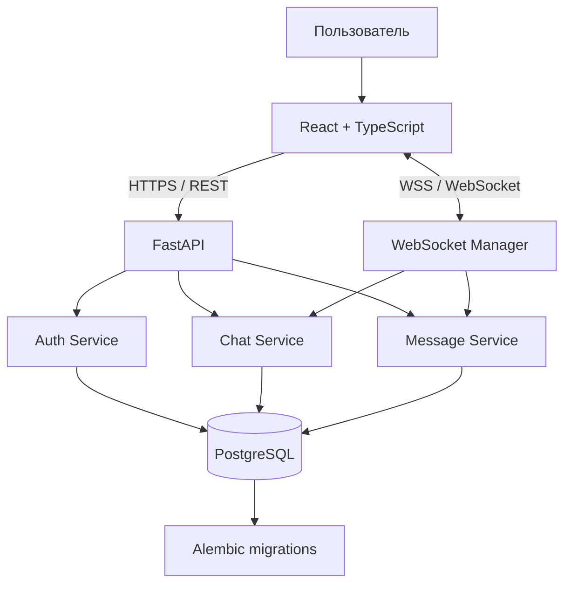
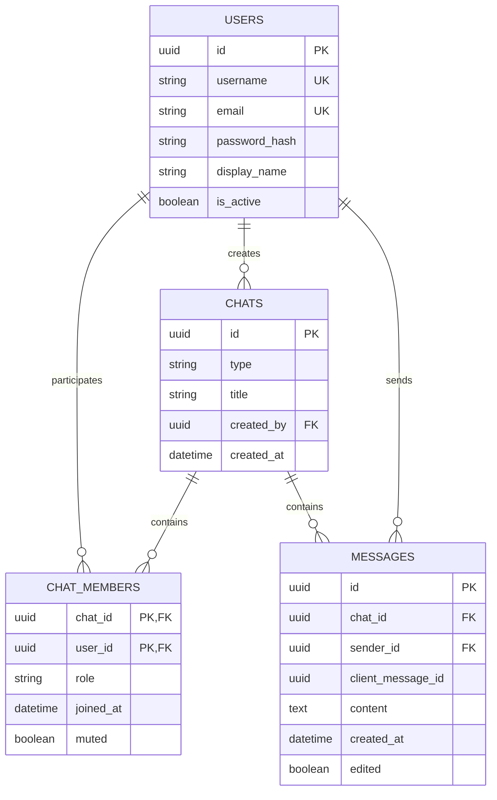

# Техническое задание: разработка веб-мессенджера Realtime Messenger

**Версия:** 1.0  
**Тип проекта:** учебный full-stack проект с акцентом на Backend и System Design  
**Основной язык Backend:** Python 3.12+  
**Основная СУБД:** PostgreSQL  
**Архитектурный подход:** модульный монолит  
**Среда разработки:** Docker Compose

---

# 1. Роль и общие инструкции для Codex

Ты выступаешь в роли Senior Backend Engineer и Software Architect. Твоя задача — разработать веб-мессенджер с личными и групповыми чатами, доставкой сообщений в реальном времени, хранением истории, поиском и базовыми средствами управления участниками.

Работай как инженер, который отвечает за работоспособность, безопасность, тестируемость и сопровождаемость проекта.

## 1.1. Правила разработки

1. Перед написанием кода изучи содержимое существующего репозитория. Не удаляй и не перезаписывай существующие файлы без необходимости.
2. Если репозиторий пустой, создай проект с нуля в соответствии с данным ТЗ.
3. Реализуй приложение поэтапно. Не пытайся создать всю систему одним большим изменением.
4. После каждого этапа запускай доступные тесты, линтеры и проверки типов.
5. Не оставляй фиктивные реализации, незавершённые заглушки, неработающие маршруты и кнопки без обработчиков.
6. Не используй глобальные изменяемые структуры данных в качестве постоянного хранилища пользователей, чатов или сообщений.
7. Не помещай бизнес-логику целиком в HTTP-обработчики.
8. Не допускай доступа пользователя к чужим чатам и сообщениям без соответствующих прав.
9. Все секреты, пароли и ключи должны передаваться через переменные окружения.
10. Не создавай дополнительные микросервисы без обоснованной необходимости.
11. Не изменяй публичные API-контракты без обновления документации и тестов.
12. Если возникает неоднозначность, выбирай наиболее простое безопасное решение, соответствующее MVP, и фиксируй решение в документации.

## 1.2. Обязательные документы проекта

Создай следующие документы:

- `README.md` — описание проекта, установка и запуск.
- `SPEC.md` — настоящее техническое задание.
- `docs/ARCHITECTURE.md` — архитектура, компоненты и потоки данных.
- `docs/DATABASE.md` — схема БД, связи и индексы.
- `docs/API.md` — REST API и протокол WebSocket.
- `docs/SECURITY.md` — модель угроз и меры защиты.
- `docs/DEVELOPMENT.md` — порядок разработки, проверки и тестирования.
- `docs/DECISIONS.md` — журнал архитектурных решений (ADR).

Документы должны соответствовать фактической реализации.

# 2. Цель проекта

Разработать веб-мессенджер, позволяющий пользователям регистрироваться, авторизовываться, создавать личные и групповые чаты, обмениваться сообщениями в реальном времени и просматривать историю переписки.

Проект должен демонстрировать владение следующими компетенциями:

- разработка REST API;
- асинхронная обработка запросов в FastAPI;
- проектирование реляционной базы данных;
- работа с SQLAlchemy и Alembic;
- реализация WebSocket-коммуникации;
- управление аутентификацией и авторизацией;
- обеспечение целостности данных;
- написание автоматических тестов;
- контейнеризация приложения;
- основы масштабирования real-time систем.

# 3. Границы проекта

## 3.1. Обязательные функции MVP

1. Регистрация пользователя.
2. Авторизация пользователя.
3. Получение информации о текущем пользователе.
4. Поиск пользователей для начала переписки.
5. Создание личного чата между двумя пользователями.
6. Создание группового чата с названием.
7. Получение списка чатов текущего пользователя.
8. Просмотр участников группового чата.
9. Добавление и удаление участников администратором группы.
10. Отправка текстовых сообщений.
11. Получение новых сообщений через WebSocket.
12. Сохранение сообщений в PostgreSQL.
13. Пагинация истории сообщений.
14. Подтверждение приёма сообщения сервером.
15. Поиск сообщений внутри конкретного чата.
16. Проверка прав доступа к чатам и сообщениям.
17. Ограничение частоты отправки сообщений.
18. Запуск приложения через Docker Compose.
19. Автоматические тесты основных сценариев.

## 3.2. Функции следующих итераций

Следующие возможности не должны блокировать завершение MVP:

- статусы прочтения по каждому пользователю;
- редактирование сообщений;
- удаление сообщений;
- реакции;
- вложения;
- упоминания пользователей;
- ответы на сообщения;
- настройки уведомлений;
- подключение Redis;
- масштабирование на несколько экземпляров Backend;
- интеграция с LLM для суммаризации переписки.

Расширения реализуются только после того, как все критерии приёмки MVP выполнены.

# 4. Технологический стек

## 4.1. Backend

- Python 3.12 или совместимая актуальная стабильная версия.
- FastAPI — HTTP API и WebSocket.
- Uvicorn — ASGI-сервер.
- Pydantic v2 — валидация данных и конфигурации.
- SQLAlchemy 2.x — ORM с асинхронным доступом к БД.
- asyncpg — драйвер PostgreSQL.
- Alembic — миграции схемы базы данных.
- PyJWT либо python-jose — работа с JWT.
- pwdlib с Argon2id — безопасное хеширование паролей.
- pytest и pytest-asyncio — тестирование.
- HTTPX — тестирование HTTP API.
- Ruff — линтинг и форматирование.
- mypy — проверка типов, где это практически применимо.

Используй совместимые стабильные версии библиотек. Зафиксируй зависимости в файле управления пакетами и не допускай неконтролируемого обновления версий.

## 4.2. База данных

PostgreSQL — единственный источник истины для пользователей, чатов, участников и сообщений.

Требования:

- внешние ключи;
- ограничения уникальности;
- индексы;
- транзакции;
- корректные правила удаления;
- временные метки в UTC;
- миграции через Alembic.

Не используй SQLite в основной конфигурации. Для тестов допускается отдельная тестовая база PostgreSQL.

## 4.3. Frontend

- React.
- TypeScript.
- Vite.
- React Router.
- TanStack Query для серверного состояния.
- React Hook Form и Zod для форм и валидации.
- CSS Modules либо обычный CSS с компонентной структурой.
- Нативный WebSocket API браузера.

Выбери один основной подход к стилям и не смешивай несколько UI-фреймворков без необходимости.

## 4.4. Инфраструктура

- Docker.
- Docker Compose.
- PostgreSQL.
- pytest.
- GitHub Actions для CI, если используется GitHub.

На этапе MVP Redis, Kafka, RabbitMQ, Kubernetes и отдельные микросервисы не требуются.

# 5. Архитектура приложения

Используй модульный монолит: один Backend-процесс с логически разделёнными модулями.

## 5.1. Схема компонентов



HTTP API используется для регистрации, авторизации, создания чатов, загрузки истории и поиска.

WebSocket используется для отправки сообщений, получения новых сообщений и событий подтверждения доставки.

PostgreSQL хранит все постоянные данные.

WebSocket Manager управляет активными соединениями в рамках одного экземпляра приложения. На MVP допускается хранение информации об активных соединениях в памяти процесса, поскольку это не постоянные бизнес-данные.

## 5.2. Принцип отправки сообщения

Сообщение должно сохраняться в БД до подтверждения успешной отправки клиенту.

Последовательность:

1. Клиент отправляет событие `message.send`.
2. Сервер проверяет WebSocket-сессию.
3. Сервер проверяет участие пользователя в чате.
4. Сервер валидирует текст и идентификатор сообщения.
5. Сервер сохраняет сообщение в PostgreSQL в транзакции.
6. Сервер фиксирует транзакцию.
7. Сервер возвращает отправителю `message.ack`.
8. Сервер отправляет `message.new` подключённым участникам чата.
9. При недоступности получателя сообщение остаётся в БД и доступно при последующей загрузке истории.

Для MVP подтверждение `message.ack` означает, что сервер успешно сохранил сообщение. Оно не означает, что получатель прочитал сообщение.

## 5.3. Границы модулей

**Auth** отвечает за регистрацию, проверку паролей, выдачу JWT и идентификацию пользователя.

**Users** отвечает за профиль пользователя и поиск по имени пользователя.

**Chats** отвечает за создание чатов, список чатов, участников и права администраторов.

**Messages** отвечает за создание сообщений, историю, поиск и проверки доступа.

**Realtime** отвечает за WebSocket-соединения, обработку событий и рассылку участникам.

**Core** содержит конфигурацию, обработку ошибок, общие зависимости и логирование.

# 6. Структура репозитория

Организуй проект следующим образом:

```text
realtime-messenger/
├── backend/
│   ├── app/
│   │   ├── main.py
│   │   ├── api/
│   │   │   ├── router.py
│   │   │   └── v1/
│   │   │       ├── auth.py
│   │   │       ├── users.py
│   │   │       ├── chats.py
│   │   │       └── messages.py
│   │   ├── core/
│   │   │   ├── config.py
│   │   │   ├── security.py
│   │   │   ├── exceptions.py
│   │   │   └── logging.py
│   │   ├── db/
│   │   │   ├── session.py
│   │   │   ├── base.py
│   │   │   └── models/
│   │   ├── schemas/
│   │   ├── repositories/
│   │   ├── services/
│   │   ├── websocket/
│   │   │   ├── manager.py
│   │   │   ├── protocol.py
│   │   │   └── endpoint.py
│   │   └── dependencies/
│   ├── migrations/
│   ├── tests/
│   │   ├── conftest.py
│   │   ├── unit/
│   │   ├── integration/
│   │   └── e2e/
│   ├── alembic.ini
│   ├── pyproject.toml
│   └── Dockerfile
├── frontend/
│   ├── src/
│   │   ├── app/
│   │   ├── components/
│   │   ├── features/
│   │   │   ├── auth/
│   │   │   ├── chats/
│   │   │   ├── messages/
│   │   │   └── users/
│   │   ├── hooks/
│   │   ├── lib/
│   │   ├── pages/
│   │   ├── services/
│   │   └── types/
│   ├── package.json
│   ├── tsconfig.json
│   └── Dockerfile
├── docs/
├── .github/
│   └── workflows/
├── docker-compose.yml
├── .env.example
├── .gitignore
├── SPEC.md
└── README.md
```

Допускается уточнение структуры по мере реализации, но сохраняй разделение между HTTP-слоем, бизнес-логикой, доступом к данным и WebSocket-слоем.

# 7. Модель данных PostgreSQL

Используй UUID в качестве первичных ключей основных сущностей.

## 7.1. Таблица users

Поля:

- `id` — UUID, первичный ключ;
- `username` — уникальное имя пользователя;
- `email` — уникальный адрес электронной почты;
- `password_hash` — хеш пароля;
- `display_name` — отображаемое имя;
- `created_at` — время создания;
- `updated_at` — время последнего обновления;
- `is_active` — признак активности учётной записи.

Правила:

- нормализуй `username` и `email` при регистрации;
- уникальность обеспечивается ограничениями БД;
- пароль никогда не хранится в открытом виде;
- не возвращай `password_hash` в API;
- для неактивного пользователя авторизация и отправка сообщений запрещены.

## 7.2. Таблица chats

Поля:

- `id` — UUID;
- `type` — `direct` или `group`;
- `title` — название группы, nullable для личного чата;
- `created_by` — UUID пользователя;
- `created_at`;
- `updated_at`;
- `last_message_at` — nullable.

Правила:

- личный чат содержит ровно двух участников;
- групповой чат содержит не менее двух участников;
- личный чат не должен дублироваться для одной пары пользователей;
- название группы обязательно для группового чата;
- личный чат не имеет изменяемого названия группы.

Для предотвращения дублирования личных чатов создай таблицу ключей личных чатов либо отдельное ограничение с канонической парой UUID. Выбранное решение должно обеспечивать целостность на уровне БД, а не только проверкой в Python.

## 7.3. Таблица chat_members

Поля:

- `chat_id` — UUID, внешний ключ;
- `user_id` — UUID, внешний ключ;
- `role` — `admin` или `member`;
- `joined_at` — время вступления;
- `muted` — флаг отключения уведомлений;
- `last_read_message_id` — nullable, резерв для расширения статусов прочтения.

Составной первичный ключ: `(chat_id, user_id)`.

Правила:

- один пользователь не может дважды состоять в одном чате;
- создатель группы становится администратором;
- удалять участника группы может только администратор;
- нельзя удалить пользователя из чата, к которому он не принадлежит;
- удаление последнего администратора группы должно быть запрещено, если перед этим не назначен другой администратор.

## 7.4. Таблица messages

Поля:

- `id` — UUID;
- `chat_id` — UUID, внешний ключ;
- `sender_id` — UUID, внешний ключ;
- `client_message_id` — UUID, переданный клиентом;
- `content` — текст сообщения;
- `created_at` — время создания;
- `updated_at` — nullable;
- `edited` — boolean;
- `deleted_at` — nullable.

Ограничения:

- текст сообщения не может быть пустым после удаления пробелов;
- максимальная длина текста — 10 000 символов;
- индекс по `(chat_id, created_at, id)`;
- уникальность `(sender_id, client_message_id)` для идемпотентной отправки.

`client_message_id` позволяет клиенту повторить запрос после потери соединения, не создавая дубликат сообщения.

Если повторно приходит тот же идентификатор с тем же содержимым и чатом, сервер возвращает существующее сообщение. Если идентификатор используется с другими параметрами, сервер возвращает конфликт.

## 7.5. Таблица message_reactions

Реализована как расширение MVP. Хранит `message_id`, `user_id` и `emoji`; составной первичный ключ не позволяет пользователю повторно поставить одну и ту же реакцию на сообщение. История сообщений возвращает агрегаты реакций и отмечает реакцию текущего пользователя.

Миграция `20261011_0005` добавляет ответы через `messages.reply_to_message_id`, а также таблицы `message_mentions` и `message_attachments`. Упоминания связываются с участником чата, файлы с сообщением, отправителем и чатом. Курсор прочтения и mute хранятся в `chat_members.last_read_message_id` и `chat_members.muted`. Отдельные записи receipt на каждое сообщение пока не создаются.

## 7.6. ER-диаграмма



Все внешние ключи и правила удаления должны быть определены явно. Не используй каскадное удаление сообщений или чатов без обоснования. Учитывай, что удаление пользователя не должно случайно разрушать историю переписки.

# 8. Аутентификация и безопасность

## 8.1. Регистрация

Пользователь передаёт:

- `username`;
- `email`;
- `password`;
- `display_name`.

Требования:

- пароль не менее 12 символов;
- максимальная длина пароля ограничена, например, 128 символами;
- проверка формата email;
- проверка уникальности username и email;
- хеширование пароля с Argon2id;
- корректная обработка гонок при одновременной регистрации одинаковых имён.

## 8.2. Авторизация

Для MVP используй JWT access token.

Токен должен включать:

- `sub` — UUID пользователя;
- `iat` — время выпуска;
- `exp` — время истечения;
- `jti` — уникальный идентификатор токена.

Рекомендуемый срок жизни access token — 15–30 минут.

Не используй секрет, захардкоженный в исходном коде. Алгоритм подписи должен быть явно задан и проверяться сервером.

Для упрощённого MVP допускается отсутствие refresh-токенов. В документации зафиксируй, что при истечении access token пользователь должен авторизоваться повторно.

Для production-ориентированного расширения предпочтительно реализовать refresh-токены с ротацией и отзывом.

## 8.3. WebSocket-аутентификация

При установлении WebSocket-соединения сервер должен идентифицировать пользователя и проверить токен.

Не передавай токен в URL-параметрах, поскольку URL может попадать в логи и другие системы наблюдения.

Предпочтительный вариант для браузера:

- HTTP-only cookie;
- Secure cookie в HTTPS;
- SameSite и корректная проверка Origin;
- короткоживущий access token.

Допускается передача токена первым сообщением протокола, если сервер не разрешает бизнес-события до успешной аутентификации. Этот вариант необходимо документировать отдельно.

При истечении токена соединение должно закрываться либо требовать повторной авторизации по определённому протоколу.

## 8.4. Проверки доступа

Перед каждым действием с чатом сервер обязан проверить членство пользователя в этом чате.

Проверки обязательны для:

- получения истории;
- поиска сообщений;
- отправки сообщений;
- получения событий по WebSocket;
- добавления участников;
- удаления участников;
- изменения настроек чата.

Нельзя полагаться на то, что frontend скрывает недоступные элементы интерфейса.

## 8.5. Защита от злоупотреблений

Реализуй:

- ограничение частоты отправки сообщений;
- ограничение размера входящего WebSocket-сообщения;
- ограничение длины текста;
- проверку формата UUID;
- ограничение количества запросов поиска;
- ограничение количества подключений на пользователя;
- закрытие неактивных WebSocket-соединений;
- безопасную обработку ошибок;
- отсутствие паролей, JWT и полного содержимого личной переписки в логах.

Начальные лимиты должны задаваться конфигурацией. Например, 10 сообщений за 10 секунд на пользователя и ограничение размера WebSocket-события до 16 КиБ. Эти значения являются стартовыми параметрами, а не универсальными production-лимитами.

# 9. REST API

Базовый префикс: `/api/v1`.

Формат запросов и ответов — JSON. Даты возвращаются в ISO 8601 с часовым поясом UTC.

Для ошибок используй единый формат:

```json
{
  "error": {
    "code": "CHAT_ACCESS_DENIED",
    "message": "You do not have access to this chat"
  }
}
```

Не возвращай пользователю traceback и внутренние детали SQL-ошибок.

## 9.1. Аутентификация

| Метод | Endpoint | Назначение |
|---|---|---|
| POST | `/auth/register` | Регистрация |
| POST | `/auth/login` | Авторизация |
| POST | `/auth/logout` | Выход, если реализовано управление сессией |
| GET | `/users/me` | Информация о текущем пользователе |

`POST /auth/register`

Пример запроса:

```json
{
  "username": "daniel",
  "email": "daniel@example.com",
  "password": "Example-Secure-Password-2026",
  "display_name": "Daniel"
}
```

При успехе возвращается созданный профиль без хеша пароля.

`POST /auth/login`

При успехе возвращается access token либо устанавливается защищённая cookie — в зависимости от выбранной схемы авторизации.

Коды ошибок должны различать неверные учётные данные, конфликт регистрации и невалидный запрос, не раскрывая лишнюю информацию о существовании аккаунтов.

## 9.2. Пользователи

| Метод | Endpoint | Назначение |
|---|---|---|
| GET | `/users/search?q=...` | Поиск пользователей |
| GET | `/users/me` | Текущий пользователь |

Поиск должен возвращать только активных пользователей, ограничивать размер результата и не раскрывать email других пользователей без необходимости.

## 9.3. Чаты

| Метод | Endpoint | Назначение |
|---|---|---|
| GET | `/chats` | Список чатов |
| POST | `/chats/direct` | Создание или получение личного чата |
| POST | `/chats/group` | Создание группы |
| GET | `/chats/{chat_id}` | Информация о чате |
| GET | `/chats/{chat_id}/members` | Список участников |
| POST | `/chats/{chat_id}/members` | Добавление участника |
| DELETE | `/chats/{chat_id}/members/{user_id}` | Удаление участника |

`GET /chats` должен поддерживать пагинацию и сортировку по последней активности.

Пример создания группы:

```json
{
  "title": "Backend Team",
  "member_ids": [
    "00000000-0000-4000-8000-000000000001",
    "00000000-0000-4000-8000-000000000002"
  ]
}
```

Сервер автоматически добавляет создателя в группу с ролью `admin`.

Создание личного чата должно быть идемпотентным на уровне бизнес-операции: повторный запрос для той же пары участников возвращает существующий чат.

## 9.4. История сообщений

| Метод | Endpoint | Назначение |
|---|---|---|
| GET | `/chats/{chat_id}/messages` | Получение истории |
| GET | `/chats/{chat_id}/messages/search?q=...` | Поиск сообщений |

Для истории используй cursor-based pagination, а не OFFSET для последовательной прокрутки больших историй.

Параметры:

- `limit` — количество сообщений, по умолчанию 50, максимум 100;
- `before` — курсор для загрузки более старых сообщений.

Пример ответа:

```json
{
  "items": [
    {
      "id": "00000000-0000-4000-8000-000000000010",
      "chat_id": "00000000-0000-4000-8000-000000000020",
      "sender_id": "00000000-0000-4000-8000-000000000001",
      "content": "Привет!",
      "created_at": "2026-10-10T10:00:00Z",
      "edited": false
    }
  ],
  "next_cursor": "opaque-cursor-or-null"
}
```

Сортировка должна быть детерминированной по `(created_at, id)`. При пагинации сервер возвращает более старые сообщения, а frontend располагает их в хронологическом порядке.

Поиск выполняется только в пределах чатов, участником которых является текущий пользователь. Используй параметризованные запросы. Для MVP допускается поиск по подстроке через PostgreSQL `ILIKE`; для более эффективного поиска позднее можно добавить полнотекстовый поиск или trigram-индексы.

# 10. WebSocket-протокол

Endpoint: `/api/v1/ws`.

Все события должны иметь единый конверт:

```json
{
  "type": "event.name",
  "request_id": "00000000-0000-4000-8000-000000000030",
  "payload": {}
}
```

`request_id` связывает запрос клиента с ответом сервера. Для отправки сообщений дополнительно используется `client_message_id` для идемпотентности.

## 10.1. Подключение

1. Клиент устанавливает WebSocket-соединение.
2. Сервер аутентифицирует пользователя.
3. Сервер регистрирует соединение в WebSocket Manager.
4. Сервер подтверждает подключение событием `connection.ready`.
5. При закрытии соединения сервер удаляет его из реестра.

При неуспешной аутентификации сервер закрывает соединение с подходящим кодом и не принимает бизнес-события.

## 10.2. События клиента

### `message.send`

```json
{
  "type": "message.send",
  "request_id": "00000000-0000-4000-8000-000000000030",
  "payload": {
    "chat_id": "00000000-0000-4000-8000-000000000020",
    "client_message_id": "00000000-0000-4000-8000-000000000040",
    "content": "Привет!"
  }
}
```

Сервер проверяет членство, валидирует сообщение, сохраняет его и подтверждает результат.

### `ping`

Клиент может отправлять heartbeat-события. Сервер отвечает `pong` либо использует стандартный WebSocket Ping/Pong, если это поддерживается инфраструктурой.

## 10.3. События сервера

### `connection.ready`

Подтверждает успешную аутентификацию и готовность принимать события.

### `message.ack`

Подтверждает, что сообщение сохранено сервером.

```json
{
  "type": "message.ack",
  "request_id": "00000000-0000-4000-8000-000000000030",
  "payload": {
    "client_message_id": "00000000-0000-4000-8000-000000000040",
    "message": {
      "id": "00000000-0000-4000-8000-000000000010",
      "chat_id": "00000000-0000-4000-8000-000000000020",
      "sender_id": "00000000-0000-4000-8000-000000000001",
      "content": "Привет!",
      "created_at": "2026-10-10T10:00:00Z",
      "edited": false
    }
  }
}
```

### `message.new`

Уведомляет подключённых участников чата о новом сохранённом сообщении. Отправитель также может получить это событие; frontend должен устранять дубликаты по `message.id`.

### `error`

Сообщает об ошибке обработки события. Ответ должен содержать стабильный машинный код и безопасное текстовое описание.

## 10.4. Доставка и повторные попытки

Не обещай exactly-once доставку через WebSocket.

В рамках MVP гарантируется следующее:

- успешный `message.ack` означает сохранение сообщения в БД;
- повторная отправка с тем же `client_message_id` не создаёт дубликат;
- подключённые участники получают событие после сохранения сообщения;
- при отключении клиента сообщение остаётся доступным через REST API;
- после переподключения клиент загружает историю с последнего известного сообщения.

Для MVP достаточно at-least-once поведения на уровне клиентских повторов и идемпотентной записи. Надёжная фоновая доставка событий при падении процесса может быть добавлена позднее через transactional outbox.

# 11. Правила бизнес-логики

## 11.1. Личные чаты

- Личный чат создаётся между двумя разными пользователями.
- Один и тот же чат не создаётся повторно для той же пары.
- Нельзя создать личный чат с самим собой.
- Оба участника могут отправлять сообщения.
- Посторонние пользователи не могут читать историю или получать события.

## 11.2. Групповые чаты

- Группу создаёт авторизованный пользователь.
- Создатель автоматически получает роль администратора.
- Администратор может добавлять и удалять участников.
- Обычный участник не может управлять составом группы.
- Нельзя добавлять несуществующих или неактивных пользователей.
- Удалённый участник теряет доступ к истории и событиям группы.
- Изменение состава группы должно быть атомарным.

## 11.3. Сообщения

- Сообщение принадлежит конкретному чату и отправителю.
- Отправитель обязан быть участником чата.
- Сообщение сохраняется до подтверждения успешной отправки.
- Время создания задаётся сервером.
- Сообщения имеют стабильный порядок.
- Ошибка доставки WebSocket не должна удалять сохранённое сообщение.

## 11.4. Статусы

В MVP необходимо различать:

- `pending` — клиент отправил сообщение, но ещё не получил подтверждение;
- `sent` — сервер сохранил сообщение и вернул подтверждение.

Статус `read` не входит в MVP.

Не называй сообщение «прочитанным» только потому, что оно было отправлено сервером или доставлено в WebSocket.

# 12. Frontend и пользовательский интерфейс

## 12.1. Экран авторизации

Содержит:

- форму регистрации;
- форму входа;
- отображение ошибок валидации;
- индикатор загрузки;
- переход к списку чатов после успешной авторизации.

## 12.2. Основной экран

Рекомендуемая компоновка:

- левая панель — список чатов и поиск;
- центральная панель — активный чат;
- верхняя часть — название чата и участники;
- нижняя часть — поле ввода и кнопка отправки.

Если чат не выбран, показывается нейтральный экран с предложением выбрать или создать чат.

## 12.3. Список чатов

Отображает:

- название личного или группового чата;
- последнее сообщение;
- время последней активности;
- непрочитанные сообщения — только после реализации соответствующего механизма;
- кнопку создания группы;
- поиск пользователей и чатов.

Не отображай фиктивные статусы прочтения в MVP.

## 12.4. Окно переписки

Функции:

- отображение сообщений в хронологическом порядке;
- визуальное различие своих и чужих сообщений;
- отправка сообщения по кнопке и клавише Enter;
- перенос строки по Shift+Enter;
- вставка эмодзи из панели выбора;
- добавление и снятие реакций на сообщения с realtime-обновлением;
- индикатор ожидания подтверждения;
- загрузка более старых сообщений;
- сохранение позиции прокрутки при загрузке истории;
- обработка отключения и повторного подключения WebSocket;
- устранение дубликатов по идентификатору сообщения.

При получении старых сообщений интерфейс не должен резко прокручивать пользователя вниз, если он читает историю.

## 12.5. Управление группой

Модальное окно создания группы:

- название;
- поиск пользователей;
- выбор участников;
- кнопка создания.

В окне информации о группе администратору доступны добавление и удаление участников. Обычный участник не видит административные действия, но окончательная проверка прав всегда выполняется на сервере.

## 12.6. Состояния интерфейса

Для всех основных экранов предусмотрены:

- загрузка;
- пустое состояние;
- ошибка;
- успешное состояние;
- отсутствие соединения;
- повторное подключение;
- истечение авторизации.

Интерфейс должен быть адаптивным и пригодным для использования на мобильном экране.

# 13. Конфигурация и запуск

Создай `.env.example` с параметрами:

```dotenv
APP_NAME=Realtime Messenger
APP_ENV=development
API_V1_PREFIX=/api/v1

DATABASE_URL=postgresql+asyncpg://messenger:change_me@db:5432/messenger

JWT_SECRET_KEY=replace_with_secure_random_secret
JWT_ALGORITHM=HS256
ACCESS_TOKEN_EXPIRE_MINUTES=20

CORS_ORIGINS=http://localhost:5173

MESSAGE_MAX_LENGTH=10000
MESSAGE_RATE_LIMIT_COUNT=10
MESSAGE_RATE_LIMIT_WINDOW_SECONDS=10
```

Это пример конфигурации, а не production-набор секретов. Не используй эти значения по умолчанию для реального развёртывания.

В Docker Compose должны запускаться:

- `backend`;
- `frontend`;
- `db`.

Требования:

- PostgreSQL использует volume для постоянных данных;
- healthcheck базы данных;
- Backend ожидает готовности БД;
- миграции запускаются контролируемо;
- сервисы общаются внутри Docker-сети;
- опубликованы необходимые порты;
- секреты не зашиваются в Docker-образы.

В README опиши команды запуска, миграций, тестирования и остановки.

# 14. Тестирование

## 14.1. Unit-тесты

Проверить:

- валидацию пользовательских данных;
- хеширование и проверку пароля;
- выпуск и проверку JWT;
- правила членства в чатах;
- права администратора;
- проверку длины сообщения;
- логику идемпотентности;
- обработку ошибок.

## 14.2. Integration-тесты

Проверить работу с PostgreSQL:

- регистрация и уникальность пользователя;
- создание личного чата;
- создание группового чата;
- добавление и удаление участников;
- сохранение сообщений;
- пагинация истории;
- поиск сообщений;
- откат транзакций при ошибках.

## 14.3. WebSocket-тесты

Проверить:

1. Подключение авторизованного пользователя.
2. Отклонение подключения без корректной аутентификации.
3. Отправку и сохранение сообщения.
4. Получение `message.ack`.
5. Получение `message.new` другим участником.
6. Отказ постороннему пользователю.
7. Повторную отправку одного `client_message_id`.
8. Обработку невалидного события.
9. Ограничение размера сообщения.
10. Закрытие соединения и повторное подключение.

## 14.4. End-to-end сценарий

Сценарий должен воспроизводить полный путь:

1. Пользователь A регистрируется.
2. Пользователь B регистрируется.
3. A авторизуется.
4. A создаёт личный чат с B.
5. B получает доступ к чату.
6. A отправляет сообщение.
7. Сообщение сохраняется в PostgreSQL.
8. B получает `message.new` по WebSocket.
9. B отключается и подключается повторно.
10. B загружает историю и видит сохранённое сообщение.

Дополнительно проверить создание группы, права администратора и поиск.

Тесты должны работать с отдельной тестовой БД и не затрагивать пользовательские данные разработки.

# 15. Нефункциональные требования

## 15.1. Надёжность

- Сохранённые сообщения не теряются при отключении получателя.
- Ошибки сети обрабатываются без аварийного завершения приложения.
- Повторная отправка не создаёт дубликаты.
- Неуспешная транзакция не приводит к частичному изменению состояния.

## 15.2. Производительность

Целевые показатели для локальной демонстрационной среды:

- обычные REST-запросы — ориентир до 300 мс на 95-м перцентиле;
- сохранение сообщения и подтверждение — ориентир до 300 мс на 95-м перцентиле;
- передача сообщения подключённому участнику — ориентир до 500 мс на 95-м перцентиле.

Показатели измеряются на оговорённой тестовой нагрузке. Они не являются гарантией для произвольного оборудования.

Для проверки подготовь небольшой нагрузочный сценарий: например, 50 одновременных WebSocket-соединений и 10 сообщений в секунду в течение нескольких минут. Измеряй задержки, ошибки и использование ресурсов.

## 15.3. Поддерживаемость

- типизация Python-кода;
- понятные имена функций и классов;
- отсутствие дублирования бизнес-логики;
- автоматические миграции;
- документация API;
- единый формат ошибок;
- логирование без утечки секретов;
- разделение unit-, integration- и e2e-тестов.

# 16. Порядок разработки

Реализуй проект по этапам.

## Этап 0. Анализ и планирование

- Изучи репозиторий.
- Создай план реализации.
- Зафиксируй архитектуру и технологические решения.
- Подготовь документы.
- Определи команды запуска и проверки.

Результат: утверждённая структура проекта и план.

## Этап 1. Инфраструктура

- Создай Backend и Frontend.
- Настрой Docker Compose.
- Подключи PostgreSQL.
- Реализуй конфигурацию через переменные окружения.
- Настрой Alembic.
- Добавь healthcheck.

Критерий завершения: проект запускается локально, приложение отвечает на health endpoint, БД доступна.

## Этап 2. Аутентификация

- Создай модель пользователя.
- Реализуй регистрацию и вход.
- Настрой Argon2id и JWT.
- Реализуй получение текущего пользователя.
- Добавь unit- и integration-тесты.

Критерий завершения: пользователь регистрируется, авторизуется и получает защищённый доступ к API.

## Этап 3. Чаты и участники

- Реализуй модели чатов и участников.
- Реализуй создание личных чатов.
- Реализуй создание групп.
- Реализуй список чатов.
- Добавь роли участников.
- Реализуй административное управление участниками.
- Покрой сценарии тестами.

Критерий завершения: все операции с чатами корректно проверяют права доступа.

## Этап 4. Сообщения и история

- Реализуй модель сообщений.
- Добавь отправку и сохранение.
- Добавь идемпотентность.
- Реализуй cursor-based pagination.
- Реализуй поиск.
- Добавь индексы БД.
- Проверь целостность транзакций.

Критерий завершения: сообщения сохраняются, история доступна после перезапуска, поиск работает только в разрешённых чатах.

## Этап 5. WebSocket

- Реализуй WebSocket Manager.
- Добавь аутентификацию соединения.
- Реализуй протокол событий.
- Добавь отправку, подтверждение и рассылку сообщений.
- Добавь проверку членства и rate limit.
- Покрой сценарии WebSocket-тестами.

Критерий завершения: два пользователя могут обмениваться сообщениями в реальном времени.

## Этап 6. Frontend

- Реализуй экраны входа и регистрации.
- Реализуй список чатов.
- Добавь создание личных и групповых чатов.
- Реализуй окно переписки.
- Добавь историю с загрузкой вверх.
- Подключи WebSocket.
- Реализуй обработку ошибок и повторное подключение.

Критерий завершения: весь основной пользовательский сценарий доступен из браузера.

## Этап 7. Качество и документация

- Запусти весь набор тестов.
- Исправь ошибки.
- Проверь миграции на чистой БД.
- Добавь CI.
- Проверь отсутствие секретов в репозитории.
- Обнови документацию.
- Подготовь инструкции демонстрации.

Критерий завершения: новый разработчик может запустить проект по README без ручного исправления исходного кода.

# 17. Критерии приёмки MVP

Проект считается готовым, если:

- [ ] Пользователь может зарегистрироваться и войти.
- [ ] Пароли хранятся только в виде безопасных хешей.
- [ ] Пользователь может найти другого пользователя.
- [ ] Можно создать личный чат без дубликатов.
- [ ] Можно создать групповой чат.
- [ ] Создатель группы становится администратором.
- [ ] Только администратор может управлять участниками группы.
- [ ] Сообщения сохраняются в PostgreSQL.
- [ ] Новые сообщения приходят подключённым участникам через WebSocket.
- [ ] Сервер подтверждает сохранение сообщения.
- [ ] История поддерживает загрузку старых сообщений.
- [ ] Поиск работает в пределах конкретного чата.
- [ ] Нельзя получить доступ к чужому чату подменой UUID.
- [ ] Повторная отправка не создаёт дубликаты.
- [ ] Ограничена частота отправки сообщений.
- [ ] Frontend корректно обрабатывает потерю соединения.
- [ ] Проект запускается через Docker Compose.
- [ ] Миграции работают на чистой БД.
- [ ] Unit-, integration- и WebSocket-тесты проходят.
- [ ] README содержит рабочие инструкции.

# 18. Архитектурные ограничения и дальнейшее масштабирование

Не внедряй Redis, Kafka и микросервисы до тех пор, пока не реализован и не протестирован MVP.

При этом архитектура должна допускать последующее развитие.

Следующие расширения выполнять отдельными этапами:

1. **Redis Pub/Sub** — межпроцессная рассылка событий при нескольких экземплярах Backend.
2. **Transactional Outbox** — надёжная публикация событий после фиксации транзакции.
3. **Refresh-токены** — продление сессии и отзыв токенов.
4. **Статусы прочтения** — реализован курсор последнего прочитанного сообщения на участника чата с realtime-обновлением; отдельная квитанция для каждого сообщения отложена.
5. **Редактирование и удаление** — реализованы для автора с realtime-обновлением; удаление мягкое.
6. **Вложения** — реализована загрузка на локальный диск с ограничением размера и проверкой доступа; переход на S3-совместимое хранилище отложен.
7. **Упоминания, ответы, mute, реакции и браузерные уведомления** — реализованы.
8. **LLM-суммаризация** — отложена до выбора провайдера; сейчас провайдер не настроен.

Для каждого существенного расширения добавляй ADR с описанием проблемы, вариантов решения, выбранного подхода и его компромиссов.

# 19. Итоговые требования к Codex

Не пытайся реализовать все этапы одновременно.

В начале работы:

1. Проанализируй репозиторий.
2. Составь краткий план этапов и рисков.
3. Подготовь структуру проекта.
4. Реализуй первый этап.
5. Проверь результат тестами и командами запуска.
6. Сообщи, какие файлы созданы, какие проверки выполнены и что осталось сделать.

После завершения каждого этапа обновляй документацию и переходи к следующему только после устранения блокирующих ошибок.

**Главный принцип:** сначала корректный и безопасный модульный монолит, затем расширение функциональности и масштабирование. Не усложняй архитектуру ради использования технологий, которые пока не нужны.
